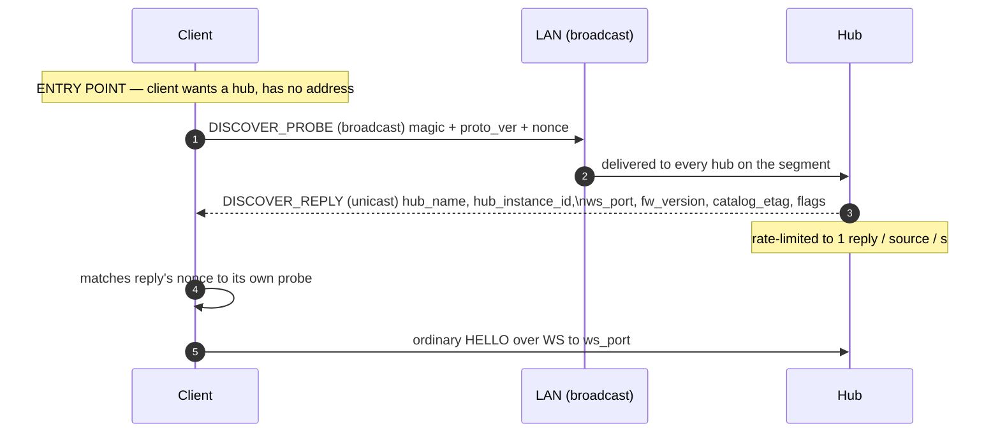

<!-- ==========================================================
     GENERATED FILE — DO NOT EDIT.
     Source of truth: spec/SPEC.md
     Generator:       docs-site/tools/gen_spec_pages.py
     Regenerate:      python docs-site/tools/gen_spec_pages.py
     CI gate:         python docs-site/tools/gen_spec_pages.py --check
     Normative text is copied verbatim. Hand edits are overwritten
     and fail the docs build. Edit the specification instead.
     ========================================================== -->

# Transport bindings and the relay role

## 13. Transport Bindings *(normative)* {#s13}

### 13.0 What conformance binds: duties, not topology *(RFC-056)* {#s13-0}

Conformance is defined over the **wire** and the **duties**, never over topology. A conformant hub MAY be implemented across multiple processors, cores or physical devices in any arrangement, provided the composite satisfies the golden vectors ([§17.2](conformance.md#s17-2)), the [§6.3](session.md#s6-3) session lifecycle, the role and trust layers, and the [§13.1](#s13-1) property declarations for whichever bindings it exposes. A client MUST NOT be able to tell the difference, and MUST NOT probe for it. **An internal link between hub components is not a Valence binding and has no conformance duty of its own**: it may be any transport at all, including a [§13.5](#s13-5) serial link carrying Valence frames, and it is invisible to conformance; it is never the binding a client reached, so it never carries serial's tier ([§12.2](security.md#s12-2)). The two HTTP escapees of [§1](foundations.md#s1) item 8 are duties of the composite hub in the same sense (RFC-057).

### 13.1 The binding contract {#s13-1}

A binding implements four operations — `open`, `close`, `write(frame)`, `read → frame` — and declares its properties. Valence above the binding line is transport-blind. The matrix every implementation codes against:

| Binding | `max_frame` (header-incl.) | Payload MTU | Ordered | Reliable | Congestion signal | ESTOP preempt point | Worst-case added ESTOP delay* |
|---|---|---|---|---|---|---|---|
| WebSocket | 512 | 504 | yes | yes (TCP) | egress queue watermark | front of egress queue | in-flight TCP bytes |
| ESP-NOW | **250** | **242** | **no** | **no** | ACK-bitmask loss % | front of radio queue | one airtime slot (~1 ms) |
| BLE GATT | 244 (ATT_MTU 247 − 3) | 236 | notifications: yes | no (notify) / yes (write-rsp) | notify queue depth | front of notify queue | one connection interval |
| Serial (COBS) | 512 | 504 | yes | yes† | TX buffer watermark | byte-level injection | one frame length |
| In-process | configurable (default 250) | configurable | configurable | configurable | simulated | simulated | simulated |

\* added by the binding, beyond queue-front admission — see [§11.2](safety.md#s11-2)'s honesty clause H2. † USB CDC; raw UART is reliable in practice, CRC-carrying frames (ESTOP) self-protect, and the STATE/STREAM classes tolerate loss by design.

The ESP-NOW line is the **normative floor**: `min_transport_payload` = 242 comes directly from it, every mandatory control message and every STATE payload MUST fit it ([§9.1](channels.md#s9-1)), and anything relying on more is a per-binding luxury. A hub MAY advertise a smaller `max_frame` than its binding permits; it MUST NOT advertise a larger one.

**Conformance profiles (RFC-043).** Which bindings a hub MUST offer depends on what it is:

- **Base profile** (simulators, hosted hubs, relays, in-process test hubs): any **single** binding conforms. A hub with no radio at all — a desktop simulator talking only in-process, a hub behind an existing gateway — is a fully legitimate Valence citizen.
- **Hardware hub profile** (an embedded hub; RFC-121). A hardware hub is reached by one of two routes, and there is no third. **With radios (or any IP interface):** it MUST implement WebSocket over its IP network; WebSocket is its floor. BLE GATT is a convenience on top of it, serving sessions only in config mode ([§13.4](#s13-4), [§13.4](#s13-4).1), and is MUST where config mode is offered; ESP-NOW is an add-on for accessories ([§13.3](#s13-3).1) and remotes. It MAY also offer serial for a client on the cable. **Without radios:** a hub with no IP interface is reached over serial only ([§13.5](#s13-5); USB on every known target), one client by the binding's nature, and has no config mode. A hub with radios whose WiFi and BLE (and so ESP-NOW) a device or user setting has disabled is on this route while they stay disabled; the config-mode gesture turns them on for that boot ([§13.4](#s13-4).1). More clients over one serial link is a relay's job ([§14](#s14)), and serial's tier stays with the client on the cable ([§12.2](security.md#s12-2)). No configuration has BLE or ESP-NOW as the only radio route: a hub whose radios offer clients BLE, ESP-NOW or both without WebSocket is not conformant. *Informative:* Valence is built for dense streams to many clients; a device that only speaks BLE belongs to an ecosystem built for that.
- **Serving a UI is a capability, never a conformance requirement.** A hub with no web assets to serve is fully conformant, and a client MUST NOT assume the hub it is talking to serves one.
- **BLE finds, WebSocket controls** (RFC-121). BLE is how a client finds a machine and, in config mode, provisions it; WebSocket is how it controls one. A client that found a hub by BLE advertisement connects over WebSocket, at the endpoint the scan-response record carries ([§13.4](#s13-4)) or one [§13.8](#s13-8) discovery returns. More generally, where a hub exposes several bindings, a client SHOULD prefer the highest-throughput one the matrix above declares (RFC-056).
- **The credential-entry duty (RFC-056).** A client that can provision a hardware hub MUST provide a way for the user to enter WiFi credentials: the [§13.9](#s13-9) push over BLE or serial (RFC-069), a form, a QR scan, an SD card, whatever suits it. The spec mandates the capability, never the mechanism; without it a factory-fresh hub with no BLE would have no route onto a network.

All of the above is availability policy, stated so a client knows what to expect from an arbitrary hardware hub — it changes no wire format.

### 13.2 WebSocket {#s13-2}

Subprotocol **`valence.v1`** in the upgrade handshake — this is version negotiation for free, and it lets a legacy protocol coexist on a different path or subprotocol during migration. **The server MUST perform RFC 6455 subprotocol selection and echo `valence.v1` in the upgrade response.** Strict clients hard-fail without the echo — two independent WS server libraries had to be patched to comply, which is why this is a sentence rather than an assumption. One Valence frame = one WS **binary** message; no batching at the WS layer, since bundles already amortize. Text messages on a `valence.v1` socket are a protocol error (close 1002). The server is the hub. RECOMMENDED endpoint: `/valence` on the primary HTTP port.

### 13.3 ESP-NOW {#s13-3}

Datagram binding: 250-byte payload − 8-byte header = 242. Unicast per peer where peers are few; broadcast segments follow [§10.6](qos.md#s10-6).

Reliability layer: every data frame carries its header seq; receivers emit a batched **ACKMASK** frame (`0x16`, raw, channel 0) every 10 ms — payload `base_seq:u16, mask:u32` — acknowledging seqs `base..base+31`. Senders use the resulting loss rate as the [§10.3](qos.md#s10-3) congestion signal. There is **no retransmission of STATE or STREAM** (those classes do not need it); control-plane frames use stop-and-wait retransmit (3×, 100 ms) keyed on the ACK mask. Discovery and pairing broadcast: [§13.7](#s13-7).

#### 13.3.1 ESP-NOW spoke: the accessory profile *(RFC-075)*

Accessories (a pump, a vibrator, a motorized stand) attach to a hub over ESP-NOW in a **star**: the **accessory host** (a hub) is the center, each **accessory** is a spoke (duty sets: [§17.1](conformance.md#s17-1)). Frames flow only between the host and each accessory, never accessory to accessory, and no client session runs on the spoke. The [§13.3](#s13-3) client-session binding is unchanged and MAY run beside the spoke on the same radio. Spoke frames are ordinary Valence frames ([§5.1](wire-format.md#s5-1) header), one per ESP-NOW payload; channel ids on the spoke are accessory-relative ([§8.10](catalog.md#s8-10)).

1. **ESP-NOW v1 framing is pinned (MUST).** A spoke frame MUST fit one ESP-NOW v1 payload, 250 bytes including the 8-byte header, even where the silicon supports v2 payloads, so v1-only silicon interoperates. [§5.6](wire-format.md#s5-6) fragmentation MUST NOT be used on the spoke, so an accessory never implements reassembly; anything larger moves only over the blob verb ([§8.4](catalog.md#s8-4)), which is chunked by construction.
2. **Unencrypted, by ruling (H13).** Spoke frames carry no ESP-NOW encryption and no Valence authentication: the setting is private, the range a room or a house, comparable consumer accessories are open BLE, and per-peer encryption would cap the peer list at 17 and add a key ceremony. What bounds the consequences, as obligations: an accessory MUST clamp every received actuating value into its declared `min`/`max`, so a forged command can do nothing a legitimate one could not; a host MUST NOT treat accessory telemetry as safety-grade input (no accessory value may clear a safety latch, satisfy an interlock, or gate machine motion); a client MUST NOT present spoke traffic as authenticated or private.
3. **BEACON is the hub heartbeat.** BEACON (`0x17`, raw, header channel `0x0000`) carries the pinned payload, little-endian and tail-extensible per [§5.4](wire-format.md#s5-4): `boot_id:u32 + catalog_etag:8B + flags:u8 + hub_instance_id:u64 + wifi_channel:u8` = 22 bytes (a 30-byte frame). The first three fields are the [§13.7](#s13-7) prefix. The header `seq` is the beacon sequence, incremented once per beacon per boot and compared per [§7.3](time.md#s7-3). `flags` are registry `beacon_flags`: bit0 `pairing_window_open`, bit1 `datagram_estop`, bit2 `accessory_host` (this hub runs the spoke and accepts accessory joins), bit3 `estop_latched` (this hub's `safety` snapshot shows ESTOP latched now); bits 4-7 MUST be zero. There is no PAUSE bit: pause reaches accessories through the relationship interlock as commanded safe values ([§11.6](safety.md#s11-6)), and only `estop_latched` is broadcast. A hub without a `hub_instance_id` ([§6.1](session.md#s6-1)) MUST NOT act as an accessory host. `wifi_channel` is the primary channel the hub transmits on (1 to 14); an accessory that hears a beacon leaked from an adjacent channel retunes to the named one. **Cadence:** an accessory host MUST broadcast BEACON every `spoke_beacon_interval_ms` (1000) for as long as the spoke is up, whether or not a pairing window is open, and every 500 ms while one is.
4. **Channel follow.** The host never changes channel for its accessories; it follows its access point. At boot and on every deadman fire the accessory scans channels 1 to 13 (a regional accessory MAY scan a subset), on each channel broadcasting one DISCOVER_PROBE (`0x1E`, the [§13.8](#s13-8) payload unchanged) and listening `spoke_scan_dwell_ms` (150) for a BEACON from its hub (source address and `hub_instance_id` both match its stored pairing) or, in pairing state, any BEACON with `accessory_host` and `pairing_window_open` set. An accessory host that receives a DISCOVER_PROBE on the spoke MUST answer with an immediate, out-of-cadence **broadcast** BEACON, at most one per `spoke_scan_dwell_ms` (broadcast, because a unicast answer to an unknown address would spend a peer-list entry). An accessory SHOULD scan actively (about 2 s cold join); passive listening (up to about 13 s) is also conformant. The probe only finds the hub; the beacon alone is the deadman's heartbeat. Rescan after beacon loss is the boot code path.
5. **The accessory deadman (MUST).** An accessory MUST enter its **safe state** when: (a) no BEACON from its hub (source address and `hub_instance_id` match) has arrived for `spoke_deadman_ms` (5000) or the shorter window its declaration carries, never below 2 × `spoke_beacon_interval_ms`; (b) it receives any GOODBYE (`0x11`) from its hub, whatever its code and even if the payload fails to decode; (c) it receives a valid, CRC-checked ESTOP frame ([§5.5](wire-format.md#s5-5)) from **any** source, or a BEACON from its hub with `estop_latched` set; or (d) it detects a local fault. **Only BEACON refreshes the deadman**; unicast commands do not, so one clock answers "is my hub alive". The safe state holds every actuating field (every value-bearing field of a declared INTENT schema or c2h STREAM layout) at its declared `safe` value ([§8.10](catalog.md#s8-10)) and abandons any verb in progress. **Leaving it:** from deadman, GOODBYE or fault, only on a fresh actuating command from its hub received after a matching BEACON; from ESTOP, only after a BEACON with `estop_latched` clear, and then only on a fresh command. An accessory MUST NOT restore its pre-safe values on its own. A host SHOULD broadcast GOODBYE (`REBOOTING` or `NORMAL_CLOSURE`) on the spoke before a planned reboot or spoke shutdown.
6. **Reliability.** [§13.3](#s13-3)'s ACKMASK loss signal and stop-and-wait control retransmit (3 × 100 ms) apply to each host-accessory link unchanged. STATE and STREAM are not retransmitted.
7. **ESTOP on the spoke.** A host accepts a valid ESTOP frame from any peer on its channel. On latching ESTOP the host MUST broadcast the ESTOP frame on the spoke, repeating at `estop_repeat_interval_ms` up to `estop_repeat_max` ([§11.2](safety.md#s11-2)), and MUST keep `estop_latched` set in every BEACON while the latch holds (the 1 Hz loss-recovery path for an accessory that missed every repeat). The acknowledgment is the accessory's status snapshot reporting `safe_estop`; the host stops repeating once every joined accessory has reported it and shows any that have not as unconfirmed on its accessory roster. An accessory MUST NOT rebroadcast an ESTOP frame: the spoke has no relay role.
8. **Peer limit.** ESP-IDF caps the peer list at 20 entries and the broadcast entry the beacon needs takes one, so **a host addresses at most 19 accessories by unicast**, fewer if the [§13.3](#s13-3) client binding shares the list. A host declares its accessory capacity ([§8.10](catalog.md#s8-10)); rotating peer entries to exceed it is permitted, not required.
9. **Radio coexistence.** The spoke rides the station interface on the access point's channel. A hub never operates a softAP ([§13.4](#s13-4).1).

#### 13.3.2 Accessory join *(§8.10)*

- **The pairing window.** Accessory joins use the [§12.3](security.md#s12-3) association window: one window, one timer (`pairing_window_default_s`), reported by BEACON `pairing_window_open` and `ble_adv_flags` bit0. It opens by the host's pairing control or by the `accessory-admin` `window_open` op from a `configure` session. **An accepted join is the window's single grant**, exactly as a push-to-pair knock is: the window closes after it. One press, one device.
- **JOIN_REQ** (`0x21`, raw, accessory to host, unicast). An accessory enters pairing state by its own local gesture (device-defined) or, when factory-fresh, on its own; it scans ([§13.3](#s13-3).1) for any BEACON with `accessory_host` and `pairing_window_open`, then sends JOIN_REQ to that beacon's source address, once per BEACON received, until answered. A paired accessory sends the same frame to its stored host on every reacquisition. Payload (little-endian): `accessory_id:u64 + proto_ver:u8 + declaration_etag:8B + deadman_ms:u16 + flags:u8 + fw_version:str16 + product:str16` = 52 bytes. `deadman_ms` is the declared deadman window (0 = `spoke_deadman_ms`), bounded per [§13.3](#s13-3).1. `flags` bit0 `pairing_state` (asking to pair, as opposed to rejoining); bits 1-7 zero.
- **JOIN_REPLY** (`0x22`, raw, host to accessory, unicast). Payload: `hub_instance_id:u64 + accessory_id:u64` (echoed) `+ result:u8 + flags:u8` = 18 bytes. `result` is a `join_results` value: 0 `accepted`; 1 `window_closed` (unknown accessory, no window open); 2 `capacity` (no free slice, no peer entry, or the declaration would exceed the host's advertised capacity); 3 `unsupported` (`proto_ver`); 4 `declaration_invalid` ([§8.10](catalog.md#s8-10)); 5 `not_paired` (a rejoin from an accessory the host has forgotten). `flags` bit0 `declaration_needed` (the host holds no declaration with this etag and is about to fetch it). **Every JOIN_REQ is answered** ([§4.5](foundations.md#s4-5)); answers to unknown accessories are rate-limited per source address at `udp_discovery.reply_rate_limit_per_source_s`.
- **Declaration fetch.** On `declaration_needed` the host sends BLOB_REQ (`ns = 0`); the accessory answers BLOB_CHUNK with [§8.4](catalog.md#s8-4) pacing; the host verifies SHA-256 against `declaration_etag`, sends BLOB_DONE, validates ([§8.10](catalog.md#s8-10)), and grows its catalog ([§8.6](catalog.md#s8-6)).
- **Rejoin after power loss, no window.** A host holding a record for that `accessory_id` accepts its JOIN_REQ whether or not a window is open. Equal `declaration_etag`: no transfer. Different etag (reflashed, same identity): the host refetches, revalidates and replaces the declaration in the same slice; the catalog changes per [§8.6](catalog.md#s8-6), and relationships whose target field no longer exists are disabled. After any join the accessory is in its safe state until its host commands it. A host reboot needs nothing extra: every accessory's deadman fires, it rescans, it rejoins.

*Implementation risk (informative).* Where the radio sits on a co-processor behind esp_hosted (the reference Flagship pairs an ESP32-P4 host with an ESP32-C6), ESP-NOW reaches the host through a shim with three known bugs: a send can stall; the peer table goes stale after a co-processor restart; a full peer table reports success. The deadman makes the first two fail safe on the accessory side; for the third, a host SHOULD count its own peer entries rather than trust the add result.

### 13.4 BLE GATT {#s13-4}

A NUS-shaped service (one write characteristic c→h, one notify characteristic h→c) carrying Valence frames as characteristic values, each ≤ ATT_MTU − 3.

**Identity is pinned, not per-implementation (RFC-046 item 1).** Every conformant BLE hub advertises the **same** GATT service, so a client scans for exactly one thing: service UUID `56414C45-4E43-4531-8000-000000000001` (`ble_identity.service_uuid`; the first three groups spell `VALE`/`NC`/`E1` in ASCII, deliberately, so the UUID is greppable and mnemonic rather than an opaque v4), write characteristic (c2h) `...-8000-000000000002`, notify characteristic (h2c) `...-8000-000000000003`. This is the phone-facing twin of the ESP-NOW `BEACON` frame's own per-binding discovery ([§13.7](#s13-7)).

**Advertising payload (RFC-046 item 2).** Within the legacy ≤ 31-byte advertising budget: the service UUID and a shortened hub name. The fuller name and one flags byte (`ble_adv_flags`) ride the **scan response** instead (active scan required to read it) — the advertisement's own budget (service UUID + shortened name = 27 B) has no room left for a 5 B Manufacturer-Specific-Data record alongside them. **The record layout is pinned (RFC-072; tail by RFC-121):** AD type `0xFF` (Manufacturer Specific Data), then `company_id:u16le` = `0xFFFF` (`ble_identity.msd_company_id`) and `flags:u8`, then, only while `ws_available` is set, the endpoint: `ipv4` (4 B, network order, as WELCOME key 47 packs it) and `ws_port:u16le`. AD length is `0x04` without the endpoint and `0x0A` with it (192.168.1.229 port 80 appends `C0 A8 01 E5 50 00`). A client reads the flags only from the record carrying that company id, from the first byte after it, ignores bytes past what it knows, and reads the endpoint only from a record long enough to hold it, with `ws_available` set and neither field 0. With the endpoint the scan response's fuller name has room for 18 B (24 B without). (Whether to keep `0xFFFF`, the Bluetooth SIG testing id, is an open question pre-v1.0.) The flags: bit0 `pairing_window_open` (a [§12.3](security.md#s12-3) association window is open right now — same meaning as the BEACON frame's pairing-open flag), bit1 `ws_available` (the hub currently has a live IP and a listening WebSocket port, and the record carries its endpoint), bit2 `config_mode` (the hub is in config mode for the whole mode, [§13.4](#s13-4).1, RFC-079). Bits 3–7 are reserved and MUST be zero. **The endpoint is a hint (RFC-121).** Discovery input is unauthenticated ([§13.7](#s13-7)), and anyone in radio range can advertise any address. A client MUST ignore an advertised address outside the private (RFC 1918) and link-local ranges, SHOULD present its token in proof mode ([§12.4](security.md#s12-4)) at an advertised endpoint it has not reached before, and takes the hub's identity from WELCOME's `hub_instance_id`, never from the advertisement.

**BLE sessions in config mode only (MUST NOT, RFC-121).** A hub MUST NOT serve a Valence session over BLE GATT outside config mode ([§13.4](#s13-4).1): it does not expose the GATT service. Outside config mode it MAY advertise for discovery (the same service UUID, name and record) and SHOULD advertise scannable and non-connectable. BLE therefore never carries the full catalog, only the provisioning catalog.

Clients SHOULD negotiate MTU ≥ 250 and enable data-length extension **before catalog transfer**; below that the binding declares its real MTU and the 242-byte STATE-fit rule still governs catalog *design*, while control frames fragment per [§5.6](wire-format.md#s5-6) and data frames are sized to the declared MTU at grant time by bundling less. A client stuck at the legacy 23-byte MTU cannot carry a full STATE frame at all and pays a long transfer of the provisioning catalog (visibly SYNCING).

#### 13.4.1 Config mode *(RFC-079)*

**Config mode** exists only on a hub with radios ([§13.1](#s13-1)). It is a boot mode: the hub serves its provisioning catalog (below) to every session on every binding, carries `config_mode` true in WELCOME `identity` ([§6.3](session.md#s6-3)), runs Valence sessions over BLE GATT and USB serial and no WebSocket listener, and leaves only by reboot; its catalog is fixed for the boot ([§8.6](catalog.md#s8-6)). A hub enters config mode on a **deliberate physical gesture**, device-defined (MUST where config mode is offered; the [§12.3](security.md#s12-3)(c) power-cycle gesture is unchanged and does not enter config mode); a gesture made while the hub runs takes effect by a reboot into config mode, and on a hub whose radios a setting disabled, the gesture turns them on for that boot. A hub MAY also enter config mode by its own device-defined policy (for example, holding no network credentials, or a boot-time join that fails); its retry, its reboot out and what holds config mode open are device-defined too, bound by [§12.3](security.md#s12-3)'s grant rule. A reboot a hub makes by its own policy (into config mode, out of it, or for a gesture) MUST close every session with GOODBYE `REBOOTING` first and MUST NOT happen while a motion source runs. Config mode is how a factory-fresh hub, or one moved to a new network, waits safely for credentials. In config mode the hub:

- entered by the gesture, opens the [§12.3](security.md#s12-3) association window at boot (`pairing_window_default_s`), and the pairing control re-opens it; entered by policy, opens none ([§12.3](security.md#s12-3));
- advertises BLE GATT with `ble_adv_flags` bit0 `pairing_window_open` while the window is open and bit2 `config_mode` for the whole mode;
- activates the [§13.5](#s13-5) USB serial binding alongside BLE GATT; both are first-class provisioning paths and both accept the [§13.9](#s13-9) `wifi_join`;
- associates its station only to carry out a `wifi_join` or for its own device-defined retry, and runs no WebSocket listener (`ws_available` clear);
- does not run the ESP-NOW spoke: accessory pairing waits until the hub has joined WiFi, because the spoke follows the access point's channel and there is none in config mode;
- entered by the gesture, grants `configure` to the window's first knock even when `configure` tokens exist ([§12.3](security.md#s12-3)).

**No softAP, in any mode (MUST NOT).** A hub never operates a WiFi softAP: a softAP pins the radio to its own channel, which the ESP-NOW spoke ([§13.3](#s13-3)) cannot follow. A hub that offers config mode MUST implement BLE GATT. Config mode wipes nothing: factory reset stays the deliberately harder gesture [§12.3](security.md#s12-3)(c) requires.

**Leaving config mode (MUST): by reboot.** On a successful `wifi_join` the hub commits by rebooting (ECHO `reboot_in_ms`, [§9.3](channels.md#s9-3), [§13.9](#s13-9)); a hub's policy may also reboot it out. A reboot without a config-mode condition always leaves config mode. The client connects over WebSocket after the reboot, at the ECHO's endpoint, the advertised endpoint ([§13.4](#s13-4)) or a [§13.8](#s13-8) discovery result, presenting its cached machine etag if it holds one ([§6.4](session.md#s6-4), [§8.6](catalog.md#s8-6)). If it cannot reach the hub (the phone is on another network, or the access point isolates clients) it says so in plain words and keeps looking; it does not fall back to BLE.

**The provisioning catalog (MUST, RFC-121).** In config mode the hub serves exactly: `catalog` (0x0001), `safety` (0x0003), `safety-intents` (0x0005), `safety-events` (0x000E), `provisioning` (0x000F), and, each iff the full catalog declares it, `networks` (0x0017), `network-names` (0x0018), `visible-networks` (0x0019) and `visible-networks-more` (0x001A). No other entry appears; hub identity rides WELCOME `identity`. Every entry is byte-identical to the entry with the same id in the full catalog: only membership, and so the etag ([§8.3](catalog.md#s8-3)), differs. Readiness ([§6.4](session.md#s6-4)) applies unchanged, so a client may send `wifi_join` after a download of about 2.8 KB. It declares no motion source, so no client starts motion in config mode; ESTOP, `pause` and the retained safety latch work as everywhere ([§11](safety.md#s11)).

**Clients.** The signal is the advertisement's `config_mode` bit and, in session, WELCOME `identity` `config_mode` ([§6.3](session.md#s6-3)). A client in a session whose WELCOME carried `config_mode` SHOULD open on the `setup` category (`ui_categories` 15), presented with the `wizard` pattern (RENDERING.md §10): one step per entry in authoring order ([§8.9](catalog.md#s8-9) item 4), the provisioning step showing the [§13.9](#s13-9) ECHO or NACK outcome, ending with the reboot and a WebSocket connect; after it, the client SHOULD resume on the full catalog's remaining `setup` entries before it opens the machine. It MUST render the category generically from the catalog, never a hub-specific screen and never a channel found by name. A client listing discovered hubs SHOULD mark a `config_mode` hub distinctly ("needs setup"). The provisioning catalog's entries are byte-identical to the full catalog's, so `setup` entries carry `setup` in every mode. A client SHOULD close a config-mode session it is not using for setup. A hub whose advertisement carries `ws_available` clear outside config mode is offline, not in need of setup.

### 13.5 Serial {#s13-5}

Byte pipe → **COBS** framing, delimiter `0x00`: encode each Valence frame with COBS and append `0x00`.

ESTOP scanning: the [§5.5](wire-format.md#s5-5) magic is matched on the **decoded** stream; additionally, because COBS never produces `0x00` inside a frame and re-synchronizes at every delimiter, a receiver in an unsynced or corrupt state MUST still run the four-`0xE5` scanner on **raw** bytes between delimiters. `0xE5` survives COBS encoding unchanged when no zero bytes occur in the window, and the CRC validates any candidate either way.

### 13.6 In-process (the conformance binding) {#s13-6}

The in-process binding connects hub and client roles inside one process (desktop simulator, unit tests). It is a **first-class conformance instrument** and therefore MUST support: configurable MTU (down to 242 and below), injected loss/reorder/duplication rates, injected latency and jitter, and a **deterministic mode** (seeded fault schedule plus injected clock) in which a run is bit-reproducible. The behavioral tests of [§17.3](conformance.md#s17-3) run against it; an implementation without fault injection cannot claim conformance testing.

### 13.7 Discovery {#s13-7}

- **No mDNS service record; a hostname responder only (RFC-072).** No DNS-SD service type and no TXT record exist: native clients discover WS-side hubs by the [§13.8](#s13-8) UDP probe, which carries `hub_instance_id`. A hub that serves a page SHOULD answer mDNS hostname queries for its own name (`<name>.local`; `machine.local` in the reference) so a browser can reach the served page by name. That is hostname resolution only: nothing a client browses or parses. A manually-entered address MUST always work — discovery is a convenience, never a requirement.
- **BLE:** advertising payload and identity are pinned in [§13.4](#s13-4). BLE advertisement is the **primary** discovery path for a hub in config mode: it is physically present and needs no network. For an online hub it carries a hint to its endpoint ([§13.4](#s13-4)).
- **ESP-NOW:** the hub or its relay broadcasts a **BEACON** frame (`0x17`, raw, channel 0; payload prefix: `boot_id`, catalog etag, flags; pinned in full by [§13.3](#s13-3).1) every 500 ms **only while a pairing window is open**, unless it is an accessory host, which beacons continuously per [§13.3](#s13-3).1. New peers respond to beacons, then run PAIR_REQ over unicast. Outside the window, peers must already know the segment from a previous pairing.

**Discovery is an untrusted input.** A client that auto-connects to a discovered service is one malicious hub away from parsing hostile bytes; [§5.8-5](wire-format.md#s5-8) and [§12.5](security.md#s12-5) are what bound the consequences.

### 13.8 UDP discovery *(RFC-046 item 5)* {#s13-8}

A minimal broadcast probe/reply pair, and the **canonical discovery path for every online hub** (a phone, a desktop shell, a streaming-application plugin, Intiface) — plain UDP sockets both ends, immune to the multicast/mesh-AP/Android failure modes that make mDNS unreliable in real homes, and simple enough to retire a hand-rolled DNS-SD query.

- **Port and magic** are registry-pinned (`udp_discovery`): port `22096` (`0x5650`, ASCII `VP` for "Valence Probe"), magic bytes `56 4C 4E 43` (ASCII `VLNC`) opening every probe and reply, mirroring the ESTOP frame's own magic-byte convention ([§5.5](wire-format.md#s5-5)).
- **DISCOVER_PROBE** (`0x1E`, raw, c2h): a client **broadcasts** `magic(4B) + proto_ver:u8 + nonce:u32` (client entropy, echoed in the reply so a client running several probes at once can match them).
- **DISCOVER_REPLY** (`0x1F`, raw, h2c): the hub **unicasts** back to the probe's source address: `magic(4B) + nonce:u32` (echoed) `+ hub_name:str32 + hub_instance_id:u64` (the hub's durable cross-boot identity, [§6.1](session.md#s6-1)/[§6.3](session.md#s6-3) — distinguishing two hubs sharing a name **across reboots**, which a per-boot value cannot do) `+ proto_ver:u8 + ws_port:u16 + fw_version:str16 + catalog_etag:8B + flags:u8` (bit0 `pairing_window_open`, the same philosophy as the ESP-NOW BEACON payload, plus the endpoint a BEACON has no room for). `str16`/`str32` are the fixed-width zero-padded field types of [§5.4](wire-format.md#s5-4)/RFC-026. **RFC-048 correction (operator veto of an RFC-046 decision, at landing):** this field originally carried the hub's `boot_id` (u32); RFC-046's own entry flagged that choice for veto because a boot-scoped id cannot deduplicate two hubs sharing a name across a reboot, which is this field's entire job. The reply's total payload grows from 72 to 76 bytes (the four-byte `u32`→`u64` widening); no other field moves. This layout landed with zero implementations, so the correction is free.
- **Read-only identity, no control surface.** A probe cannot command anything, and a reply discloses nothing a passive observer of a normal WELCOME could not already learn. Replies are rate-limited to `udp_discovery.reply_rate_limit_per_source_s` (1) **per source address**, so a probe storm cannot load the hub — the same posture as the BEACON frame's own broadcast cadence.
- A manually-entered address MUST still always work; this, like every discovery mechanism, is a convenience.

*A probe storm from one source only ever gets one reply per second — the
loop that would otherwise exist (retry until an answer arrives) is a client
policy, not a protocol requirement, because a manually-entered address is
always an equally valid entry point.*

**Discovery doctrine, restated for this binding:** BLE advertisement is primary for a hub in config mode and a hint to an online hub's endpoint ([§13.7](#s13-7)); the UDP probe is the discovery path for every online hub, and no mDNS service record exists to compete with it ([§13.7](#s13-7), RFC-072).

### 13.9 Provisioning: client-pushed network credentials *(RFC-069)* {#s13-9}

A factory-fresh hub has no network; the operator's phone or computer has the credentials. The spec-core INTENT channel **`provisioning` (`0x000F`)**, `configure` access, carries them in.

- **Schema** (the channel's own keys): 1 `op`, an op select with role `action.provision` over `provisioning_ops` (`wifi_join` 1; index 0 is filler, [§8.9](catalog.md#s8-9)); 2 `ssid` (tstr); 3 `passphrase` (tstr, MAY be empty for an open network); 4 `ipv4` and 5 `ws_port` (uint, result keys of the ECHO). `ssid` and `passphrase` carry the `secret` flag. A core id, not a device channel plus role, because the first-run client binds by identity and a headless hub has no other surface.
- **Gate (MUST).** The hub accepts `wifi_join` only when all hold: the session holds `configure`; a [§12.3](security.md#s12-3) association window is open, or this session was approved by a pairing-control press within `pairing_window_default_s` and has not yet used it ([§12.3](security.md#s12-3), BLE sessions), or the trust ledger is empty, or the frame arrived on serial or in-process (RFC-121); and the frame arrived on a BLE GATT ([§13.4](#s13-4)), serial ([§13.5](#s13-5)) or in-process ([§13.6](#s13-6)) binding. Otherwise NACK `ACCESS_DENIED`. A `wifi_join` MUST NOT start while a motion source runs (NACK `SOURCE_CONFLICT`): a join cuts every WebSocket session. A network binding is refused because it rides the network being changed and is cleartext (H4). The **serial binding is a first-class provisioning path beside BLE**: where config mode is offered ([§13.4](#s13-4).1), both are active at once and both accept `wifi_join`. A hub SHOULD require LE Secure Connections on a BLE link ([§12.9](security.md#s12-9)).
- **Unicast result.** The hub defers its answer until the join concludes or `provision_join_timeout_ms` elapses. Success: ECHO whose `applied` carries `op`, each credential key with the value `true` ([§8.8](catalog.md#s8-8) Secrets), and the resulting `ipv4` and `ws_port`. Failure: NACK `NETWORK_JOIN_FAILED`, whose `detail` MUST NOT contain either credential. A duplicate `intent_id` during the attempt joins it and MUST NOT start a second attempt. **In config mode** (RFC-121) the requesting session stays up through the join and gets the answer before any reboot: on ECHO (carrying `reboot_in_ms`) the hub reboots; on NACK it does not, stays in config mode, and the session continues. A `wifi_join` never commits by reboot on credentials the hub has not seen join.
- **No stranding (MUST).** A hub that already has working credentials keeps them until the new ones join; a failed join leaves the prior configuration in effect.
- **Never disclosed (MUST).** Credentials never appear in STATE, in any EVENT (including the log channel, [§16.2](errors.md#s16-2)), in GOODBYE or NACK `detail`, in any diagnostic surface, or in the ECHO of any other session. Their public consequences ride their existing homes: `ipv4` and `ws_port` in WELCOME ([§6.3](session.md#s6-3)), `ble_adv_flags.ws_available` ([§13.4](#s13-4)). A client MUST NOT log or persist the credentials beyond the send, and enters the SSID itself: the hub publishes no scan list.
- **Then the reboot.** On success the hub reboots out of config mode ([§13.4](#s13-4).1), and the client connects over WebSocket at the returned endpoint.

## 14. Relay Role *(normative)* {#s14}

### 14.1 Forwarding {#s14-1}

A relay bridges the hub's reachable transports to segments it cannot reach. Rules:

- A relay forwards **frames, not sessions**: it does not parse control-plane CBOR, does not hold grants, and is invisible to the session layer except as specified here. Clients behind a relay hold ordinary sessions with the hub.
- A relay MUST NOT bridge a client session over a BLE segment outside config mode ([§13.4](#s13-4)), and the sessions it carries never inherit a serial binding's tier ([§12.2](security.md#s12-2), RFC-121).
- **Priority-aware buffering:** a relay MUST maintain at least two queues per direction — critical (the never-shed set plus the ESTOP fast path) and everything else — and MUST apply [§10.4](qos.md#s10-4)-style shedding when its downstream is slower than its upstream, **including the segment exception**: it decimates `samples`-kind streams and conflates STATE by replacing queued frames for the same channel with newer ones, but it MUST NOT decimate a `segments`-kind stream. A relay that blindly FIFOs is non-conformant: it converts congestion into latency, which for motion data is the worst outcome ([§9.2](channels.md#s9-2)).
- A relay MAY further decimate below granted rates when its segment demands it; the hub's congestion machinery observes the resulting loss and re-grants honestly ([§10.3](qos.md#s10-3)), so the system converges without the relay speaking the grant protocol.

### 14.2 ACK aggregation and the ESTOP fast path {#s14-2}

- **Reliability is hop-by-hop.** The relay acknowledges what it receives from its segment and takes responsibility for upstream delivery, and vice versa. There are no end-to-end transport acknowledgments across a relay.
  **HONESTY CLAUSE (H10), stated plainly:** the hub knowing a frame reached the relay does **not** mean the client got it. This is safe because no protocol correctness depends on transport delivery — STATE re-pushes, STREAM tolerates loss, and the only end-to-end confirmations that exist are protocol-level: **INTENT ⇒ ECHO** and **ESTOP ⇒ observed latch**.
- **ESTOP fast path:** on matching the four-`0xE5` magic with a raw scanner — no deframing, no queueing — a relay MUST transmit the frame onward on **all** attached segments ahead of every queued frame, then resume normal operation. CRC validation MAY be deferred to endpoints when the relay's budget is tight: forwarding a corrupt candidate costs 12 bytes; dropping a real one costs much more.

### 14.3 Timestamp correction and limits {#s14-3}

A relay that buffers — adds more than 1 ms of asymmetric delay — MUST satisfy **exactly one** of:

**(a) correct** — stamp arrival and, on transmit, rewrite STREAM `t_base` by its holding time;
**(b) be CLOCK-transparent** — forward CLOCK frames with strict priority, under 1 ms of added delay;
**(c) drop CLOCK frames entirely** ([§7.1](time.md#s7-1)), degrading its clients to WELCOME-bootstrap accuracy.

Silent uncorrected buffering of CLOCK is non-conformant. Note that (a) matters doubly for `segments`-kind streams, where `t_base` is a **schedule**, not an observation ([§5.4](wire-format.md#s5-4)): an uncorrected relay does not merely blur a graph, it moves commands in time.

**The relay ESTOP latency budget (RFC-049f).** A relay MUST forward an ESTOP-class frame ahead of every buffered frame on all attached segments ([§14.2](#s14-2)) and MUST add no more than **one binding-native frame-transmission time** in doing so. Composed with H2's per-hop accounting, the end-to-end ESTOP guarantee across a single relay is the binding's own worst-case added latency ([§13.1](#s13-1)) **plus exactly one relay-hop budget** — never an unbounded function of the relay's queue depth. This is the same H2/[§13.1](#s13-1)-style worst-case accounting the transport matrix already states, extended one hop further.

**Relays MUST NOT chain — one relay hop maximum in v1 — and the reason is architectural, not arbitrary (RFC-049f).** The ESTOP budget above and [§13.1](#s13-1)'s worst-case-added-latency accounting are bounded specifically *because* there is exactly one hop to bound: a chain of relays would compound that worst case with no ceiling the spec states — two 250 ms buffering relays in series could turn a binding's 50 ms guarantee into 550+ ms and nothing here would call it non-conformant. v1 also defines no routing or loop-protection protocol a relay could use to discover, bound, or refuse a chain it finds itself part of; chaining without that missing machinery is unsafe, not merely unspecified. Multi-hop is a v2 problem nobody currently has, and it gets its own RFC precisely when a real topology needs the routing and multi-hop latency accounting this one lacks — not because chaining is conceptually forbidden.
